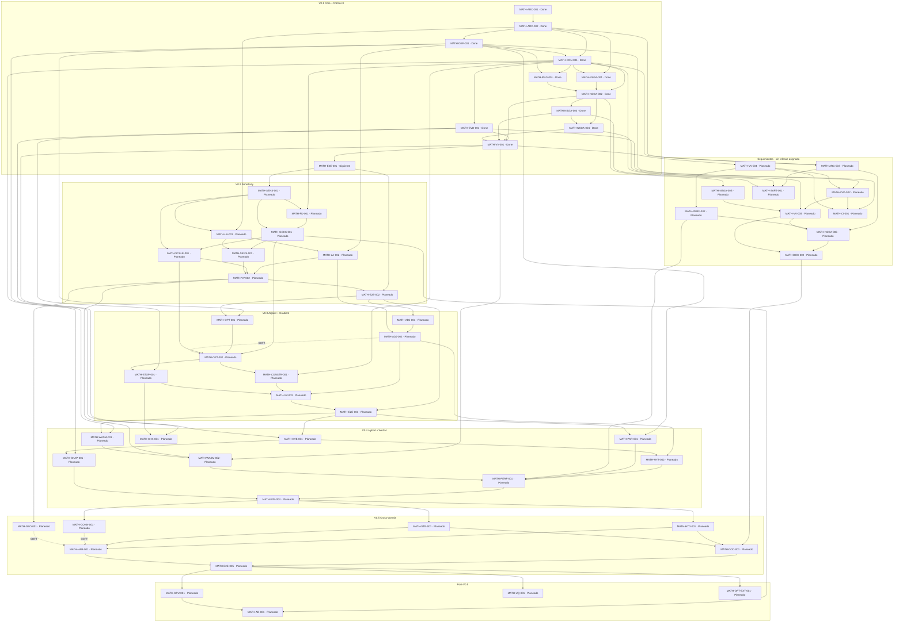

<!-- Generated by scripts/planning/build_dag.py; do not hand-edit. -->
# DAG de ejecución · snapshot 2026-11-02

Fuente: [Notion](https://app.notion.com/p/f3f9f65000d64435a415324e64d4a32b). Consulta: 2026-11-02 22:16:41 UTC.
59 tickets; 113 HARD; 3 SOFT internas; 3 SOFT externas. HARD acíclico.

Las flechas van del prerequisito al dependiente. SOFT no bloquea.
Las capas son estructurales: no son ondas autorizadas ni una ruta crítica por duración.
Estado, release, snapshot, conflictos y STOP del ticket siguen siendo gates independientes.

Entrada por tabla: MATH-E2E-001.
Planeado con HARD satisfechas (NO iniciar): MATH-ARC-003, MATH-VV-004, MATH-NSGA-005.
E2E-001 conserva su STOP después de M2; preparar el DAG no autoriza C1/C2/C3.

## Grafo completo



## Capas topológicas completas

Incluyen Done y Planeado, sin simular cierres ni cambiar releases.

| Capa | Tickets |
| --- | --- |
| 0 | MATH-ARC-001 |
| 1 | MATH-ARC-002 |
| 2 | MATH-DEP-001 |
| 3 | MATH-CON-001 |
| 4 | MATH-RNG-001, MATH-EVD-001, MATH-NSGA-001, MATH-ARC-003 |
| 5 | MATH-NSGA-002 |
| 6 | MATH-NSGA-003, MATH-NSGA-005 |
| 7 | MATH-NSGA-004, MATH-SAFE-001 |
| 8 | MATH-VV-001 |
| 9 | MATH-E2E-001, MATH-VV-004 |
| 10 | MATH-EVD-002, MATH-PERF-002, MATH-SENS-001 |
| 11 | MATH-VV-005, MATH-CI-001, MATH-FD-001, MATH-LA-001 |
| 12 | MATH-NSGA-006, MATH-GCHK-001, MATH-LA-002 |
| 13 | MATH-DOC-002, MATH-SENS-002, MATH-SCALE-001 |
| 14 | MATH-VV-002 |
| 15 | MATH-E2E-002, MATH-GEO-001 |
| 16 | MATH-ADJ-001, MATH-OPT-001 |
| 17 | MATH-ADJ-002, MATH-OPT-002 |
| 18 | MATH-CONSTR-001, MATH-STOP-001 |
| 19 | MATH-VV-003, MATH-CHK-001 |
| 20 | MATH-E2E-003 |
| 21 | MATH-HYB-001, MATH-PAR-001, MATH-WASM-001 |
| 22 | MATH-HYB-002, MATH-SNAP-001, MATH-WASM-002 |
| 23 | MATH-PERF-001 |
| 24 | MATH-E2E-004 |
| 25 | MATH-HYD-001, MATH-STR-001, MATH-CONN-001 |
| 26 | MATH-HAR-001, MATH-DOC-001 |
| 27 | MATH-E2E-005 |
| 28 | MATH-GPU-001, MATH-UQ-001, MATH-OPT-EXT-001 |
| 29 | MATH-AD-001 |

## Gates por ticket

Entrada=TABLA significa Siguiente y HARD Done; aún exige preflight, snapshot y autorización vigente.

| Ticket | Estado | Release | HARD pendientes | Entrada |
| --- | --- | --- | --- | --- |
| [MATH-ARC-001](https://app.notion.com/3ea721d30f85813fb00ad9c7286cacf7) | Done | V0.1 Core + NSGA-III | Ninguna | Cerrado |
| [MATH-ARC-002](https://app.notion.com/3ea721d30f8581f09412fea6c61888d3) | Done | V0.1 Core + NSGA-III | Ninguna | Cerrado |
| [MATH-DEP-001](https://app.notion.com/3ea721d30f8581038128e92c1aaf6c18) | Done | V0.1 Core + NSGA-III | Ninguna | Cerrado |
| [MATH-CON-001](https://app.notion.com/3ea721d30f85810c8f79f2ffdcd4b7b2) | Done | V0.1 Core + NSGA-III | Ninguna | Cerrado |
| [MATH-RNG-001](https://app.notion.com/3ea721d30f8581e49723c24b598d369f) | Done | V0.1 Core + NSGA-III | Ninguna | Cerrado |
| [MATH-EVD-001](https://app.notion.com/3ea721d30f858102b756e0a4487b3424) | Done | V0.1 Core + NSGA-III | Ninguna | Cerrado |
| [MATH-NSGA-001](https://app.notion.com/3ea721d30f8581ed8398e34aff4f0f55) | Done | V0.1 Core + NSGA-III | Ninguna | Cerrado |
| [MATH-NSGA-002](https://app.notion.com/3ea721d30f85811fae8ae0271e986d74) | Done | V0.1 Core + NSGA-III | Ninguna | Cerrado |
| [MATH-NSGA-003](https://app.notion.com/3ea721d30f8581e391abf5b1e3d49337) | Done | V0.1 Core + NSGA-III | Ninguna | Cerrado |
| [MATH-NSGA-004](https://app.notion.com/3ea721d30f85816ea8e1c87f72d169bf) | Done | V0.1 Core + NSGA-III | Ninguna | Cerrado |
| [MATH-VV-001](https://app.notion.com/3ea721d30f85812785b2d3d3bbea1856) | Done | V0.1 Core + NSGA-III | Ninguna | Cerrado |
| [MATH-E2E-001](https://app.notion.com/3ea721d30f8581b092e8dd433014a7f9) | Siguiente | V0.1 Core + NSGA-III | Ninguna | TABLA |
| [MATH-ARC-003](https://app.notion.com/40c721d30f85814e847ddc6b7f46f322) | Planeado | Sin asignar | Ninguna | NO |
| [MATH-VV-004](https://app.notion.com/40c721d30f85810ea908e812fe455868) | Planeado | Sin asignar | Ninguna | NO |
| [MATH-EVD-002](https://app.notion.com/40c721d30f8581b7858cd41d10e1899e) | Planeado | Sin asignar | MATH-VV-004 | NO |
| [MATH-NSGA-005](https://app.notion.com/40c721d30f8581188964c71303df1d0f) | Planeado | Sin asignar | Ninguna | NO |
| [MATH-VV-005](https://app.notion.com/40c721d30f858141a694c59dbad96fea) | Planeado | Sin asignar | MATH-EVD-002, MATH-NSGA-005 | NO |
| [MATH-PERF-002](https://app.notion.com/40c721d30f8581b6a38bfe5d22dbd24b) | Planeado | Sin asignar | MATH-VV-004 | NO |
| [MATH-NSGA-006](https://app.notion.com/40c721d30f8581668ac8c6c6f53d70ca) | Planeado | Sin asignar | MATH-ARC-003, MATH-PERF-002, MATH-VV-005 | NO |
| [MATH-SAFE-001](https://app.notion.com/40c721d30f8581f89ffdcbbc26ed326d) | Planeado | Sin asignar | MATH-ARC-003 | NO |
| [MATH-CI-001](https://app.notion.com/40c721d30f85812a837be2b14161bf0f) | Planeado | Sin asignar | MATH-EVD-002, MATH-VV-004 | NO |
| [MATH-DOC-002](https://app.notion.com/40c721d30f858197a8f6fa6f73f27bd3) | Planeado | Sin asignar | MATH-NSGA-006, MATH-VV-005 | NO |
| [MATH-SENS-001](https://app.notion.com/3ea721d30f858105b81aec44446417d3) | Planeado | V0.2 Sensitivity | MATH-E2E-001 | NO |
| [MATH-FD-001](https://app.notion.com/3ea721d30f8581a0a147e825ea303c8d) | Planeado | V0.2 Sensitivity | MATH-SENS-001 | NO |
| [MATH-GCHK-001](https://app.notion.com/3ea721d30f8581d7845bc22cc02d547e) | Planeado | V0.2 Sensitivity | MATH-FD-001, MATH-SENS-001 | NO |
| [MATH-LA-001](https://app.notion.com/3ea721d30f858151abbfec482aa15e19) | Planeado | V0.2 Sensitivity | MATH-SENS-001 | NO |
| [MATH-LA-002](https://app.notion.com/3ea721d30f8581b09ea8c44bb428a1e7) | Planeado | V0.2 Sensitivity | MATH-LA-001 | NO |
| [MATH-SENS-002](https://app.notion.com/3ea721d30f8581e3bcc6d240b612eb5a) | Planeado | V0.2 Sensitivity | MATH-GCHK-001, MATH-LA-001 | NO |
| [MATH-SCALE-001](https://app.notion.com/3ea721d30f8581f99d81ece57dcf00bd) | Planeado | V0.2 Sensitivity | MATH-GCHK-001, MATH-SENS-001 | NO |
| [MATH-VV-002](https://app.notion.com/3ea721d30f85812fade1fa4d9325d6cc) | Planeado | V0.2 Sensitivity | MATH-LA-002, MATH-SCALE-001, MATH-SENS-002 | NO |
| [MATH-E2E-002](https://app.notion.com/3ea721d30f85813594eee5f43543c99c) | Planeado | V0.2 Sensitivity | MATH-E2E-001, MATH-VV-002 | NO |
| [MATH-ADJ-001](https://app.notion.com/3ea721d30f8581ca945adefa1abcd1e7) | Planeado | V0.3 Adjoint + Gradient | MATH-E2E-002 | NO |
| [MATH-ADJ-002](https://app.notion.com/3ea721d30f85819a9abbc85e903a98e4) | Planeado | V0.3 Adjoint + Gradient | MATH-ADJ-001, MATH-LA-002 | NO |
| [MATH-OPT-001](https://app.notion.com/3ea721d30f8581ac82efc54ef33eddd8) | Planeado | V0.3 Adjoint + Gradient | MATH-E2E-002 | NO |
| [MATH-OPT-002](https://app.notion.com/3ea721d30f8581c0b15ce3afa5921910) | Planeado | V0.3 Adjoint + Gradient | MATH-GCHK-001, MATH-OPT-001, MATH-SCALE-001 | NO |
| [MATH-CONSTR-001](https://app.notion.com/3ea721d30f8581c28d5cf824d3123f4b) | Planeado | V0.3 Adjoint + Gradient | MATH-OPT-002 | NO |
| [MATH-STOP-001](https://app.notion.com/3ea721d30f8581bcbee4ebf7729f9360) | Planeado | V0.3 Adjoint + Gradient | MATH-OPT-002 | NO |
| [MATH-VV-003](https://app.notion.com/3ea721d30f85817ab4bae1db50eb3385) | Planeado | V0.3 Adjoint + Gradient | MATH-ADJ-002, MATH-CONSTR-001, MATH-STOP-001 | NO |
| [MATH-E2E-003](https://app.notion.com/3ea721d30f8581acbaffdbf2005c97ad) | Planeado | V0.3 Adjoint + Gradient | MATH-E2E-002, MATH-VV-003 | NO |
| [MATH-HYB-001](https://app.notion.com/3ea721d30f858114854aec10ec645786) | Planeado | V0.4 Hybrid + WASM | MATH-E2E-003 | NO |
| [MATH-HYB-002](https://app.notion.com/3ea721d30f8581cbad35fca78a55c2f7) | Planeado | V0.4 Hybrid + WASM | MATH-ADJ-002, MATH-HYB-001 | NO |
| [MATH-SNAP-001](https://app.notion.com/3ea721d30f8581099d6ed63eee59fb6f) | Planeado | V0.4 Hybrid + WASM | MATH-HYB-001 | NO |
| [MATH-PAR-001](https://app.notion.com/3ea721d30f8581fb8013ecca88198cda) | Planeado | V0.4 Hybrid + WASM | MATH-E2E-003 | NO |
| [MATH-WASM-001](https://app.notion.com/3ea721d30f8581d3967dfe683d0ce4f3) | Planeado | V0.4 Hybrid + WASM | MATH-E2E-003 | NO |
| [MATH-WASM-002](https://app.notion.com/3ea721d30f8581fdb984f33b05bff588) | Planeado | V0.4 Hybrid + WASM | MATH-VV-002, MATH-WASM-001 | NO |
| [MATH-CHK-001](https://app.notion.com/3ea721d30f8581b78accdec81d1bd82f) | Planeado | V0.4 Hybrid + WASM | MATH-STOP-001 | NO |
| [MATH-PERF-001](https://app.notion.com/3ea721d30f8581c1b026d9e39b61489d) | Planeado | V0.4 Hybrid + WASM | MATH-HYB-002, MATH-PAR-001, MATH-PERF-002, MATH-WASM-002 | NO |
| [MATH-E2E-004](https://app.notion.com/3ea721d30f8581f8874ac8e6d2c274a7) | Planeado | V0.4 Hybrid + WASM | MATH-PERF-001, MATH-SNAP-001 | NO |
| [MATH-HYD-001](https://app.notion.com/3ea721d30f8581eeb048ee0cac161f6e) | Planeado | V0.5 Cross-domain | MATH-E2E-004 | NO |
| [MATH-STR-001](https://app.notion.com/3ea721d30f8581b28df5d5bbda7532cc) | Planeado | V0.5 Cross-domain | MATH-E2E-004 | NO |
| [MATH-CONN-001](https://app.notion.com/3ea721d30f8581999797f697a7b0a32c) | Planeado | V0.5 Cross-domain | MATH-E2E-004 | NO |
| [MATH-GEO-001](https://app.notion.com/3ea721d30f858158a0d8f3d7ca7e31f5) | Planeado | V0.5 Cross-domain | MATH-VV-002 | NO |
| [MATH-HAR-001](https://app.notion.com/3ea721d30f85810183a0cc9bd782ee95) | Planeado | V0.5 Cross-domain | MATH-HYD-001, MATH-STR-001 | NO |
| [MATH-DOC-001](https://app.notion.com/3ea721d30f85814a9de8f23514b55b16) | Planeado | V0.5 Cross-domain | MATH-DOC-002, MATH-HYD-001, MATH-STR-001 | NO |
| [MATH-E2E-005](https://app.notion.com/3ea721d30f8581b1b1c9eae6c249d898) | Planeado | V0.5 Cross-domain | MATH-DOC-001, MATH-HAR-001 | NO |
| [MATH-GPU-001](https://app.notion.com/3ea721d30f8581a4bf86f99758f7338d) | Planeado | Post-V0.5 | MATH-E2E-005 | NO |
| [MATH-AD-001](https://app.notion.com/3ea721d30f858186a9e9f65efd0558cb) | Planeado | Post-V0.5 | MATH-GCHK-001, MATH-GPU-001 | NO |
| [MATH-UQ-001](https://app.notion.com/3ea721d30f8581309742fd76020d2831) | Planeado | Post-V0.5 | MATH-E2E-005 | NO |
| [MATH-OPT-EXT-001](https://app.notion.com/3ea721d30f8581109e13dfcd39db9476) | Planeado | Post-V0.5 | MATH-E2E-005 | NO |

## SOFT externas

- MATH-STR-001: MAMUT Structures analysis contracts stable.
- MATH-CONN-001: Connections design/check contracts stable.
- MATH-GEO-001: Geotechnics GroundModel/method contracts stable.

## Reproducir

```powershell
python scripts/planning/build_dag.py --check
```

Regenerar sin --check sólo después de capturar y revisar las propiedades canónicas.
El script no consulta Notion ni actualiza estados; no es un sincronizador ni un snapshot de ejecución.
